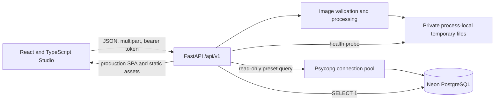
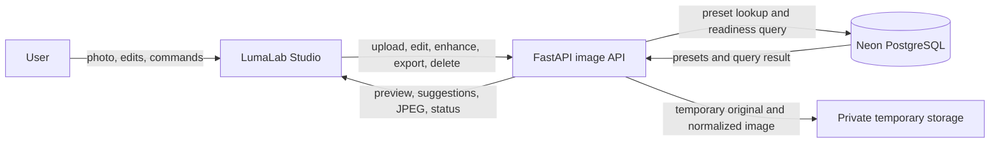

# LumaLab system architecture and data flows

## System architecture

The frontend uses the generated OpenAPI types and a shared HTTP client. The Vite development server proxies `/api` to FastAPI; the production container serves the built SPA and API from one origin. Railway terminates public HTTPS and runs one API process/replica because image sessions and processing coordination are process-local.

Image uploads are decoded and checked for format, frame count, oriented dimensions, pixel/side limits and supported colour profiles. Exact uploaded bytes, a normalized sRGB PNG and private reduced preview/analysis PNGs are kept in a private per-run directory. A random bearer token is returned once; only its hash is stored. Preview, enhancement, export and deletion require that token. Processing uses the normalized original, and preview/export return JPEG bytes directly. Originals and metadata are not written to Neon.

## MVP data model

| Entity | Storage | Fields and lifecycle |
| --- | --- | --- |
| Preset | Neon `public.presets` | Stable text ID, name, description and six bounded integer adjustment values. Seeded by an explicit owner-only command; the application role has SELECT only. |
| Image session | Process memory | Random image ID, token hash, upload/expiry timestamps, private directory and display filename. Expires after 60 minutes; maximum 32 active sessions per process. Lost at process restart. |
| Original upload | Private temporary file | Exact user bytes, retained unchanged for the session. Removed on deletion, expiry, graceful shutdown or stale-run cleanup. |
| Normalized image | Private temporary file | EXIF-oriented, sRGB, white-composited PNG used as the immutable processing source. Removed with the session. |
| Editor settings | Browser memory and request body | Six adjustment integers. The backend renders each preview/export from the normalized source; no edit history is stored. |

No account, profile, photo-library or durable image row exists in this MVP. Neon stores only the preset catalogue and migration ledger.

## Level 0 data flow

## Level 1 data flow

1. **Load Studio:** The browser requests presets. FastAPI validates rows returned by Neon. If Neon is unavailable or the built-in catalogue is invalid, the API returns a generic 503 and the Studio displays an unavailable message.
2. **Upload:** The browser checks the file locally, then sends multipart `file`. FastAPI independently enforces request and image limits, decodes one supported frame, normalizes orientation/colour/transparency and creates a temporary session. The API returns image ID, one-time bearer token, dimensions, format and expiry.
3. **Original preview:** The browser requests an authorized downscaled JPEG using the bearer token. The API reads the normalized original and returns the bytes with `no-store`.
4. **Edit:** Slider or preset changes are held in browser memory. The client sends the complete six-value adjustment state and a monotonically increasing revision. The server renders from the normalized original. The browser displays only a successful, current revision; obsolete requests are aborted/ignored.
5. **Enhance:** The server analyzes a reduced copy of the normalized source and returns a complete six-value suggestion. The browser can explicitly retry a failure; failed attempts preserve existing settings.
6. **Compare/export:** Compare overlays the original and current authoritative preview. Export submits the current complete state and returns full-resolution JPEG bytes with a safe attachment filename. The browser initiates a download and releases its blob URL.
7. **Delete/cleanup:** Closing or replacing a session sends authorized deletion. Expiry cleanup runs periodically; startup removes stale run directories and graceful shutdown removes the current run. A crash or process restart loses session tokens and volatile files.

## API contract and operations

The live OpenAPI schema is at `/api/openapi.json`; Swagger UI is at `/api/docs`. The generated frontend contract is `frontend/src/lib/api.generated.ts`. Check drift from `frontend/` with `npm run contracts:check` and regenerate only after reviewing an intentional API change with `npm run contracts:generate`.

Apply numbered SQL migrations explicitly with `uv run --locked python -m app.db.migrate`, then seed presets with `uv run --locked python -m app.db.seed` from `backend/`. Both commands require `DATABASE_DIRECT_URL` on the intended branch. The API uses the pooled, least-privilege `DATABASE_URL` and validates the preset catalogue before accepting requests. Container startup runs migrations and seeding if `DATABASE_DIRECT_URL` is supplied; omit it after a separate migration/seed release step to keep owner credentials out of the application environment. See [audit remediation and proxy configuration](AUDIT_REMEDIATION.md). See [backend setup and operations](../frontend/README.md) and [migration authoring rules](../backend/migrations/README.md).

For deployment, use the repository-root Dockerfile on Railway, provide the pooled `DATABASE_URL` as a service secret, and use one replica. Image sessions are intentionally volatile; do not mount durable photo storage for this MVP. Configure Railway's HTTPS domain and set `ALLOWED_ORIGINS` only for a separately hosted frontend.
