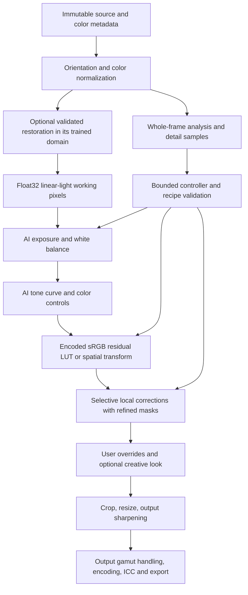

# Production photo enhancement plan for FLEX / LumaLab

Research date: 21 November 2026. Status: implementation specification; no enhancement model has been trained, benchmarked, or deployed by this planning task.

## Decision

Build an editable, color-managed photographic pipeline with learned color/tone decisions, selective corrections, and optional detail restoration. Keep Pillow and OpenCV where they are useful; replace the six-control heuristic as the source of photographic judgment. First target excellent JPEG/PNG/WebP enhancement. Add a separate RAW development path after the rendered-image pipeline passes its quality gates.

The recommended first production model is a compact controller that predicts bounded photographic controls and an image-adaptive 3D LUT. Compare a spatial model based on LUTwithBGrid/SVDLUT on the same held-out photos before selecting the final model. Add conservative local subject corrections and optional denoising only when each improves measured results. Train production models on rights-cleared professional editing pairs.

“As good as Lightroom” must mean a measured result on a declared input population. A single compressed JPEG cannot provide the sensor data available to Lightroom when it develops the original RAW. No retrieved evidence establishes that an off-the-shelf model will deliver Lightroom parity for this app. The roadmap below is a proposed route to that standard, with explicit release criteria.

Deliverables for implementation: this specification and [the ordered engineering backlog](PHOTO_ENHANCEMENT_BACKLOG.json). Source facts have links; architecture choices, estimates, parameter bounds, and release thresholds are proposals unless explicitly described as observations.

## 1. What the repository actually does

The following findings come from the current working files, including existing uncommitted work. These are code observations, not image-quality measurements.

| Area | Current implementation | Consequence |
| --- | --- | --- |
| Enhancement | `backend/app/services/images.py::enhance()` uses a maximum 512-pixel analysis image, grayscale mean/std, HSV mean saturation, and RGB channel means | Four global statistics cannot reliably distinguish intentional low-key lighting, sunsets, skin, backlighting, or mixed illumination |
| Suggestions | Brightness 80–125; contrast 90–120; saturation 90–115; warmth −15–15; sharpness/vignette zero | No exposure in stops, highlight/shadow separation, tint, local edits, noise reduction, or learned preference |
| Rendering | Pillow brightness, contrast, saturation, additive red/blue warmth, unsharp mask, vignette; intermediate image is RGB with 8-bit channels | Repeated clipping/rounding within one render can destroy smooth gradients and highlight color; warmth is not a calibrated white-balance operation |
| Color handling | `normalize()` applies EXIF orientation and converts embedded ICC profiles to sRGB; missing profiles are converted to RGB; `image.info.clear()` removes metadata | Good existing normalization foundation, but early RGB conversion discards higher precision; explicit missing-profile policy and output ICC embedding are needed |
| Sources | Private original bytes, `normalized.png`, 1600-edge `preview.png`, 512-edge `analysis.png` | Original is preserved. Current preview renders an already-reduced source, while export renders the normalized full-size source |
| Contracts | Strict Pydantic `Adjustments` contains six required integers; enhancement returns `{adjustments, message}` | A LUT, masks, denoiser, and versioned render graph cannot be represented faithfully in this object |
| Editor | `frontend/src/pages/Studio.tsx`, `frontend/src/lib/editor.ts`, and `api.ts` use the six-control state; crop/revision handling already exists | A recipe state must join the existing revision/crop/history lifecycle; six sliders must not pretend to represent a learned LUT |
| Capacity | 10,000,000-byte upload; 24 MP; 10,000-pixel maximum side; 32 sessions; 1 heavy operation and 2 preview/enhancement permits; 1 GB private-file budget; 1-hour fixed expiry | Preserve protections. A model worker cannot be added by merely increasing web-server worker count |
| Deployment | CPU-oriented container, one process/replica because storage/session/permit state is local | First release should work on CPU; GPU restoration and multi-replica operation require explicit worker/session design |
| Existing benchmark | `backend/scripts/benchmark_images.py` measures synthetic 24 MP export latency and peak RSS | Useful operational baseline; it does not measure photographic usefulness or enhancement quality |

Pillow/OpenCV are not themselves the reason for poor photographic decisions. The missing pieces are a sufficiently expressive renderer, scene-aware decisions, professionally edited training targets, and a reliable evaluation loop.

## 2. Define the Lightroom reference correctly

Adobe documents separate capabilities for color/tone adjustments, optics, masking, and detail enhancement. Its Enhance functions include Denoise, Raw Details, and Super Resolution; these have different input requirements. Super Resolution doubles width and height. These functions are not equivalent to the current Auto Enhance button. [Adobe Enhance](https://helpx.adobe.com/lightroom/desktop/edit-photos/enhance-details.html), [editing controls](https://helpx.adobe.com/lightroom/desktop/edit-photos/edit-photos.html), [masking](https://helpx.adobe.com/lightroom/desktop/edit-photos/masking.html).

Create two reference tracks:

1. **Rendered-image track, first release:** give FLEX and Lightroom exactly the same JPEG/PNG/WebP pixels and intended photographic brief. Compare FLEX against Lightroom Auto and against a professional's final Lightroom edit. Use identical crop, output size, color profile, and output compression. The expert edit is the near-final target; Lightroom Auto is an additional automated baseline.
2. **RAW track, later:** start both tools from the same supported RAW. Record decoder, camera profile, white balance, demosaic method, lens correction, and output transform. Evaluate the complete RAW workflow separately. Never compare FLEX's camera JPEG to Lightroom's RAW output and label that a fair engine comparison.

Record the Lightroom product, exact build, process/profile versions, settings/XMP when available, and whether an adaptive profile, masking, or denoising was used. Adobe's published AI workflow emphasizes dependency order and updating downstream AI edits after upstream changes; implement equivalent cache invalidation rather than copying its UI order blindly. [Adobe AI workflow](https://www.adobe.com/learn/lightroom-cc/web/lightroom-ai-order-of-operations).

The initial supported promise should be: **natural, faithful, editable enhancement that usually needs only minor finishing on supported rendered photographs.** Do not promise reconstruction of clipped JPEG highlights, missed focus, or missing sensor information.

## 3. Product behavior

Auto Enhance should create one reversible edit transaction containing an AI base recipe and its analysis revision. Manual changes remain a separate override layer.

- Default intent: Natural. Offer strength from 0 to 100, with a conservative calibrated default. Add Portrait and Landscape only after each has enough training/evaluation coverage; creative looks stay explicit presets.
- Preserve night scenes, warm sunset light, deliberate silhouettes, high-key photography, and existing monochrome intent. Lack of neutral pixels is a reason for a smaller white-balance correction.
- Protect skin hue and texture, sky gradients, highlight color, dark fabrics, foliage, text, and architectural edges.
- Run on the original source state, not on a previously enhanced JPEG. Repeated clicks must not compound corrections.
- Strength zero reproduces the no-AI render. Reset removes the AI recipe and manual overrides while preserving the independently managed crop unless the user chooses Reset All. Undo restores the complete prior state.
- Show Before/After, Auto strength, and concise edit explanations such as “Lifted the subject; preserved warm evening light.” Do not display invented confidence percentages.
- If a model is unavailable, offer the deterministic conservative result and identify it accurately. If no useful safe change is found, returning no change is acceptable.
- Noise reduction and enlargement are separate controls, off unless the user opts in or a validated policy selects conservative denoising. Never automatically change identity, objects, facial features, or image dimensions.

## 4. Renderer v2: precise, shared, and reversible

### 4.1 Color and precision contract

Use float32 RGB for calculations and a high-bit-depth lossless cache where needed. For phase one, use linear-light sRGB primaries for physical operations, with explicitly encoded sRGB at model/LUT boundaries. This is a practical SDR choice; it does not create wide-gamut or RAW headroom. Decoding a rendered JPEG to linear-light values produces **display-linear** pixels, not a recovery of the original scene radiance.

For ICC-tagged inputs, use a validated high-precision ICC conversion path. Prototype libvips plus LittleCMS and compare against reference color patches; do not assume Pillow's current `outputMode="RGB"` path preserves a 16-bit RGB source. For untagged rendered RGB inputs, assume sRGB, retain an internal warning, and document the policy. Reject unsupported color modes with a clear error until they have verified transforms.

Keep the original bytes immutable. Strip GPS/private metadata from output, but embed the correct output sRGB ICC profile. Do not confuse privacy stripping with removing the color profile. Future Display P3/16-bit TIFF/HDR output needs its own working-space and export tests.

Libvips is a candidate because its demand-driven region processing can reduce intermediate-image allocations. Its ICC transform has a defined API; validate precision, loader support, threading, and packaged native dependencies in this container. [libvips internals](https://www.libvips.org/API/current/How-it-works.html), [ICC transform](https://www.libvips.org/API/current/method.Image.icc_transform.html).

### 4.2 Fixed render graph

Use this graph for rendered SDR sources; all domains and parameters are versioned:



Local and manual operators enter/leave linear or perceptual domains explicitly; no operator may reinterpret an encoded array as linear. A restoration checkpoint trained on sRGB receives encoded sRGB with its exact expected range and channel order. Do not feed it linear RAW-derived data merely because that is convenient elsewhere in the graph.

Train the residual LUT against the output of the fixed AI photographic-control stages. Do not train the LUT to reproduce the entire expert edit and then also apply that edit's exposure/white balance: that applies the correction twice. Changing any upstream stage invalidates dependent caches and can require model retraining.

For phase one, analyze the whole oriented image and keep masks in normalized full-source coordinates. Crop is an output operation and does not silently re-estimate the style. If crop-aware re-enhancement is introduced, make it explicit and include the crop/analysis domain in the recipe identity. Future lens correction/geometry must declare coordinate mappings and invalidate masks; do not reuse masks across a changed warp.

### 4.3 Photographic controls

| Control | Required behavior | Proposed initial automatic bounds |
| --- | --- | --- |
| Exposure | Multiply linear-light RGB by `2 ** exposure_ev`; evaluate highlight headroom | −1.0 to +1.0 EV normally; exceptional cases require calibrated scene policy |
| White balance | Normalized RGB gains or a documented chromatic-adaptation transform; separate green/magenta tint; gate on evidence | Per-channel gains initially bounded to 0.85–1.18, then normalize luminance; calibrate bounds on real images |
| Tone | Monotone toe/midtone/shoulder curve; highlight/shadow masks with smooth transitions | Start with small changes; no fixed middle-gray target for every photo |
| Highlights/whites | Roll off bright values while preserving hue and avoiding gray highlights | Do not imply recovery of already clipped channels |
| Shadows/blacks | Lift selected dark regions with a noise-dependent ceiling | Preserve intended silhouettes and black anchors |
| Vibrance/saturation | Chroma-aware, hue-preserving mapping with skin protection and gamut checks | Default small vibrance; avoid blanket saturation boosts |
| Local contrast/texture | Edge-aware base/detail treatment with noise gating | Zero until validated against halos and skin artifacts |
| Sharpening | Separate capture/detail treatment from output-size sharpening | Zero on uncertain/noisy input; radius defined in source/output pixels as appropriate |

These are engineering starting bounds, not Lightroom-equivalent slider units or proven optimal values. Manual ranges can be broader, with artifact-aware behavior. Do not map old brightness percentages to EV and call the mapping equivalent.

### 4.4 Preview/export agreement

Persist one source-derived recipe, global statistics, LUT, masks, and model versions. Preview and export consume the same frozen state. Do not independently run enhancement on the thumbnail and full-size image. For spatial models, use full-image normalized coordinates and a shared guide definition. For tiled processing, use fixed global statistics, measured receptive-field overlap, and validated boundary blending.

Color-only point transforms can be evaluated on a preview efficiently, but resampling and nonlinear transforms do not commute. For final preview validation, compare a preview to a full render downsampled with the same output settings. Detail preview should include a 100% crop processed at source scale; a whole-image thumbnail cannot prove denoising quality. Mark reduced-detail previews as such.

Expose separate geometry/crop revision and recipe revision in render state. Cancel stale requests, ignore late responses, and export exactly the accepted revision. Preserve current `X-Image-Revision` behavior while extending state identity.

## 5. Enhancement intelligence and model selection

### 5.1 Analysis inputs

Use a 768–1024-edge whole-frame view for scene/color analysis and sampled full-resolution patches for noise/detail diagnostics. The precise model input size belongs in its manifest. Compute luminance percentiles in the correct domain, per-channel clipping, highlight/shadow area, color distribution, likely neutral evidence, noise level, edge/blur diagnostics, and semantic masks when available. Existing 512-edge data can remain for cheap heuristics, but is insufficient for detail-quality decisions.

Use scene indicators to bound decisions rather than hard-coded scene labels alone. A sunset classifier should lower aggressive neutralization, but must not force a warm preset. Use an out-of-distribution/uncertainty policy calibrated against held-out failures and an artifact validator. A raw softmax value is not a reliability guarantee.

### 5.2 Candidate comparison

| Candidate | Role | Decision |
| --- | --- | --- |
| Deterministic float renderer + robust controller | Reliable fallback and first improved release | Build first; use as the ablation baseline |
| Image-Adaptive 3DLUT | Global learned color/tone transform predicted from a low-resolution view | First learned baseline: compact, resolution-friendly, but cannot treat identical colors differently by location |
| LUTwithBGrid / SVDLUT | Spatially varying learned enhancement | Required challenger for difficult backlight/mixed scenes; accept only if it improves human results within latency/memory limits |
| HDRNet family | Bilateral grid of local transforms | Useful architectural baseline; original repository has legacy TensorFlow/custom-op constraints and documents a GPU-only slice/apply implementation |
| NILUT | Compact controllable style representation | Useful for later creative-style blending; not the primary scene-analysis or restoration solution |
| NAFNet denoising | Optional detail restoration | First restoration candidate, separately evaluated on this app's camera/phone/JPEG distribution |
| Restormer | Restoration challenger | Compare if NAFNet fails important noise/blur cases; expect greater deployment work rather than assume a quality win |
| Real-ESRGAN | Optional enlargement | Separate opt-in feature after natural enhancement; synthetic texture/detail risks make it unsuitable as the default color-enhancement engine |
| Generative image editing / face restoration | Content-changing output | Separate explicitly requested product mode; exclude from faithful automatic enhancement |

The adaptive LUT repository describes predicting basis-LUT weights from downsampled inputs. LUTwithBGrid and SVDLUT specifically address the missing spatial information. Their reported benchmark speed/quality is author-reported under their setup, not measured application latency. [Adaptive 3DLUT](https://github.com/HuiZeng/Image-Adaptive-3DLUT), [LUTwithBGrid](https://github.com/WontaeaeKim/LUTwithBGrid), [SVDLUT](https://github.com/WontaeaeKim/SVDLUT), [HDRNet](https://github.com/mgharbi/hdrnet), [NILUT](https://github.com/mv-lab/nilut).

NAFNet and Restormer publish task-specific restoration models; Real-ESRGAN is a restoration/super-resolution system trained with synthetic degradation. None should be described as a turnkey replacement for Lightroom's whole processing pipeline. [NAFNet](https://github.com/megvii-research/NAFNet), [Restormer](https://github.com/swz30/Restormer), [Real-ESRGAN](https://github.com/xinntao/Real-ESRGAN).

### 5.3 First learned implementation

Use an identity-initialized photographic controller plus a 33×33×33 residual LUT, initially three learned basis LUTs and identity blending. These sizes are proposed starting configurations. Predict bounded control values and nonnegative normalized basis weights from the analysis image. Add smoothness and monotonicity regularization where appropriate, and explicitly test cross-channel/gamut behavior rather than assuming those penalties guarantee safety.

Implement a vectorized CPU LUT evaluator first, with a numerical reference. Export only supported predictor operators to ONNX; LUT interpolation can remain a separately tested native/NumPy/libvips operation. Do not assume custom bilateral slicing kernels export to standard ONNX. For a spatial challenger, budget an explicit portable kernel or retain the worker's native inference engine.

The stored recipe contains the actual effective transform. It must not contain six approximate sliders that lose the LUT/mask effects. If fitting interpretable controls to expert targets leaves a residual that is consistently too large or unstable, use a directly learned transform as the AI base and label manual sliders as overrides.

### 5.4 Selective editing

Begin with subject/background exposure and highlight preservation. Add skin protection after mask quality is demonstrated across skin tones, lighting, ages, and partial faces. Use feathered, edge-aware masks and bounded local transforms. Apply an ordered layer policy or normalized overlapping weights so two masks do not accidentally double exposure.

SAM 2 is a useful option for user-assisted selection; its repository explicitly licenses code and checkpoints under Apache 2.0. It does not by itself supply reliable semantic labels such as “skin” or “sky.” Automatic semantic masks need a separately evaluated model and artifact/license record. Do not make a large segmentation model a mandatory dependency of the first global enhancement release. [SAM 2](https://github.com/facebookresearch/sam2).

### 5.5 Restoration safeguards

Only run denoising when the input diagnostics and validated policy justify it. Preserve hair, pores, fine fabrics, stars, grain, and text. Blend conservatively with the original if texture loss appears. Reject unstable color shifts. Train and evaluate RGB denoising separately from a future RAW denoiser. Benchmark full-frame and tiled output because architectures with global pooling/attention can change under naïve tiling.

For NAFNet, validate its inference/local-statistics configuration specifically; matching an overlap size alone is insufficient evidence of full-image equivalence. For any restoration model, use its correct task checkpoint, expected normalization, padding, and color domain. Loading a deblurring checkpoint does not provide denoising.

## 6. Data acquisition, rights, and training

### 6.1 Dataset decisions

| Source | Evidence and use | Production decision |
| --- | --- | --- |
| MIT–Adobe FiveK | 5,000 RAW photos, each retouched by five photography students trained on Lightroom; useful historical retouching benchmark | Published licenses restrict use to research without commercial advantage. Do not include images or associated checkpoints in a commercial training/deployment plan without appropriate permission and review |
| PPR10K | Official project reports 11,161 RAW portraits in 1,681 groups, three expert targets, human masks and editing metadata; the README has a separate dataset Agreement despite Apache 2.0 project code | The dataset Agreement restricts images and derived data to noncommercial research. Use its methods as inspiration; obtain separate permission or replacement owned portraits for production. Split research evaluations by group |
| SIDD | Paired real smartphone noise benchmark with RAW/sRGB material; official dataset page explicitly states MIT licensing for dataset and associated code repositories | Suitable licensing starting point for denoising data. Archive terms and notices with the actual files; independently record selected pretrained-checkpoint permissions and training lineage |
| HDR+ | Burst photography data; official page states CC BY-SA 4.0 | Useful later for burst/RAW research, not a direct set of expert single-image final edits; review applicable attribution/share-alike obligations for intended artifacts |
| Commissioned/owned editing pairs | Match this app's photos and desired Natural result | Preferred production foundation, with written training, derivative-model, processing, retention, and evaluation rights |

Dataset source and licensing evidence: [FiveK description](https://data.csail.mit.edu/graphics/fivek/), [Adobe license](https://data.csail.mit.edu/graphics/fivek/legal/LicenseAdobe.txt), [Adobe/MIT license](https://data.csail.mit.edu/graphics/fivek/legal/LicenseAdobeMIT.txt), [PPR10K dataset Agreement](https://raw.githubusercontent.com/csjliang/PPR10K/master/README.md), [SIDD license statement](https://abdokamel.github.io/sidd/#license), [HDR+ terms](https://hdrplusdata.org/dataset.html).

“MIT” in the FiveK name is an institution, not an MIT software license. A permissive repository software license also does not automatically resolve the separate data and pretrained-weight terms. This is an implementation dependency to resolve, not a reason to stop the color-renderer work.

### 6.2 Build a product-specific corpus

Proposed starting acquisition: 2,000 rights-cleared unique photographs, approximately 1,400 training / 200 validation / 400 locked test, assigned by shoot/scene/subject group. Treat these counts as a pilot, not proof of sufficient data. Expand when learning curves or subgroup failures warrant it. Never split crops, augmented versions, near-duplicates, or adjacent burst frames across partitions.

Include portraits across skin tones, backlit people, indoor mixed light, landscapes, foliage, sunsets, night scenes, snow/high-key scenes, food, products with known colors, architecture, and intentionally stylized/monochrome photos. Include phone HDR JPEGs, camera JPEGs, compression artifacts, unusual ICC profiles, and already-good inputs. Collect poor exposure cases that still contain recoverable detail; separately tag irrecoverable clipping/blur.

Commission experienced retouchers to produce a faithful Natural final edit at full resolution. For an initial subset, request multiple independent edits and adjudicate style differences; don't average incompatible looks. Keep a primary art direction and alternative acceptable renditions. Explicitly record “leave unchanged” examples and intentional lighting. Record local masks and edit metadata where rights and tooling allow it, but do not assume Lightroom XMP numbers have identical semantics in this renderer.

Manifest fields: source SHA-256; source/group/shoot identifiers; split; capture type; camera/phone family when available; input ICC/bit depth; input processing history; target profile/size; retoucher/style; rights record; permissible uses; mask provenance; tags; quality issues; version and hashes of input/target rendering. Keep private identity information outside the ordinary training manifest and exclude GPS from artifacts.

Do not retain ordinary app uploads for training by default. Existing sessions are temporary; corpus collection must be an explicit opt-in path with separate storage and deletion policy.

### 6.3 Training procedure

1. Freeze a deterministic source-normalization/export pipeline. Align target geometry and ICC color. Detect/reject mismatched crops, hidden resizing, and target compression artifacts before training.
2. Reproduce baseline methods on the same prepared pairs. Record input transform, split, seed, checkpoint, runtime, and license manifest. Do not compare PSNR figures from differently rendered FiveK variants as though they were directly comparable.
3. Fit photographic controls to targets through the differentiable renderer or bounded parameter search. Treat those fits as pseudo-labels with residual error, not exact expert slider truth. Train the controller; then train residual color/LUT behavior on the fixed upstream output.
4. Initial objective: color/tone reconstruction plus perceptual and structure terms, identity regularization on already-good inputs, LUT smoothness, mask-edge regularization, and skin/neutral constraints. Normalize loss terms and tune weights on validation; do not copy arbitrary published weights across color domains. Exclude adversarial/generative objectives from the faithful baseline.
5. Use paired, color-consistent augmentation. Mild corruption can model known input variation; use physical/domain-correct exposure/noise augmentations. Do not casually flip target white balance or apply arbitrary hue changes while keeping an incompatible target.
6. Train the global LUT baseline and spatial challenger on the same corpus. Ablate deterministic controls, LUT, spatial stage, local masks, and restoration. Keep a component only when it improves the primary human outcomes without violating guardrails.
7. Select hyperparameters using validation only. Run the locked test once per release candidate; publish failure slices and new data needs. A repeatedly inspected test set becomes development data and needs a new locked holdout.
8. Package versioned artifacts with provenance and reproducible preprocessing. Use a safe model format and hash allowlist; never load arbitrary user-supplied serialized model objects.

For training budget, start with a compact model on one available GPU and measure steps/sec and time to useful validation. Set fixed trial and compute ceilings before experimentation. Full-resolution restoration training is a separate budget from LUT training.

## 7. API and state design

Keep `/api/v1` and the six-slider renderer stable for old presets/sessions. Add `/api/v2/images` with shared upload validation/storage helpers and an explicit `engine_version`. A v2 session is not silently switched to v1 rendering. Avoid a lossy automatic conversion of v1 creative presets into new photographic units; preserve them through the old engine or create newly calibrated v2 equivalents.

Proposed v2 resources:

| Endpoint | Behavior |
| --- | --- |
| `POST /api/v2/images` | Validated upload; returns private session, source dimensions, supported capabilities, expiry, engine version |
| `POST /api/v2/images/{id}/enhancements` | Accepts intent, strength, source/crop context, restoration choice, and source-state revision; returns 202 with a job handle |
| `GET /api/v2/images/{id}/jobs/{job_id}` | Authenticated bounded status; `queued/running/succeeded/failed/cancelled`; completed result has recipe handle and explanations |
| `DELETE /api/v2/images/{id}/jobs/{job_id}` | Idempotent cancellation; cooperative GPU cancellation or discard-late-result policy |
| `POST /api/v2/images/{id}/preview` | Recipe handle + full override/crop state + revision; echoes accepted revision and render identity |
| `POST /api/v2/images/{id}/exports` | Bounded async full-resolution export; result fetched only with session authorization |
| `DELETE /api/v2/images/{id}` | Retires session, cancels jobs, and removes source/recipes/masks/derived files after active readers drain |

No object-storage URLs, file paths, or bearer tokens appear in model-facing metadata or logs. A recipe handle is scoped to its source/session; reject a handle from another session. Authenticated polling must not extend the fixed session lifetime by accident.

Illustrative internal recipe (design example, not a measured model output):

```json
{
  "schema_version": 2,
  "engine_version": "photo-v2.0.0",
  "source_sha256": "<immutable-source-hash>",
  "source_revision": 0,
  "analysis_domain": "full-oriented-source",
  "intent": "natural",
  "strength": 0.65,
  "color_pipeline": "display-linear-srgb-f32-v1",
  "ai_controls": {
    "exposure_ev": 0.25,
    "white_balance_gains": [1.02, 1.0, 0.98],
    "tone_curve_id": "<validated-monotone-curve>"
  },
  "residual_transform_id": "<immutable-lut-or-grid-artifact>",
  "local_layers": [],
  "restoration": {"enabled": false, "artifact_id": null},
  "model_manifest_id": "<approved-artifact-manifest>",
  "fallback_reason": null
}
```

Store manual overrides separately: exposure/tint/tone/vibrance/detail parameters, crop, preset version, and revision. Effective render identity hashes the source, engine, color pipeline, recipe artifacts, overrides, crop, output dimensions, and encoding settings. Cache the AI analysis separately from manual renders so a small slider move does not run the model again.

Define strength as interpolation from identity to the validated **AI transformation** at fixed graph stages, with separate behavior for restoration. Identity endpoint tests are mandatory. Do not apply strength again to a recipe that already incorporated it. Manual overrides are not attenuated by the AI strength slider.

Backend schemas should use finite floats, bounded arrays, literal versions, strict validation, and `extra="forbid"`. The existing TypeScript contract generator supports limited unions; extend it deliberately for new schemas/status responses, or use a maintained OpenAPI generator. Regenerate contracts; do not hand-edit `api.generated.ts`.

## 8. Deployment, performance, and reliability

### 8.1 Two operating modes

**CPU-first release:** keep one web replica and private process-local sessions; run one bounded local enhancement worker with controlled OpenCV/BLAS/ONNX thread counts. Begin with deterministic controls and a compact predictor/LUT. Expensive optional restoration can remain disabled. Keep the API responsive by using jobs rather than blocking a request for full processing.

**GPU release:** separate the model worker from the web process. Use an authenticated job queue and private source/derived storage with lifecycle deletion. Before adding web replicas, migrate authorization/session metadata and coordination out of Python process memory, or intentionally keep the web tier single-replica. GPU workers fetch only scoped work and return immutable artifacts; they do not own session authorization.

Use a worker process initially so memory or native-library failures can be isolated. Limit total admission by bytes/pixels, job type, in-flight buffers, and measured model peak memory. A request-count semaphore is insufficient when workloads differ significantly. The parent owns sessions; workers receive scoped file descriptors or private paths, not mutable copies of the session registry. Reserve derived-storage bytes atomically before writing, publish artifacts atomically, and release reservations on failure/cancellation. Include recipes, masks, and export files in the 1 GB budget. Hold explicit bounded job leases so session retirement cannot delete a source still being read; reject late publication after deletion or expiry.

### 8.2 Proposed operational targets

These are provisional budgets to validate, not measured performance. Benchmark warm and cold starts separately with recorded hardware, model, image corpus, concurrency, thread settings, and quality settings.

| Workload | Initial target on declared test hardware |
| --- | --- |
| Manual color-only preview, up to 1600 edge | p95 server render ≤500 ms warm, excluding network |
| CPU Natural enhancement job | p95 end-to-end job ≤3 s warm at supported admission; report queue and compute separately |
| CPU 24 MP export without restoration | p95 ≤10 s; bounded memory; no preview starvation |
| GPU restoration of supported 24 MP source | p95 ≤15 s warm, subject to checkpoint/tile configuration |
| Session/privacy/cross-revision contract | Zero known cross-session access or wrong-revision exports in verification |

Use 4 vCPU / 8 GiB as a proposed CPU benchmark profile and a separately recorded GPU profile, not as confirmed current infrastructure. Recalibrate budgets after the first working renderer. A smaller deployment may need fewer sessions or slower admitted jobs.

A 24,000,000-pixel RGB float32 buffer occupies 288,000,000 bytes, about 274.7 MiB. Four such buffers occupy about 1.07 GiB before decoding, model activations, or runtime memory. Avoid full-frame temporary arrays for every operator; use streamed/region processing where correct. Account for libvips caches and codec buffers as well as NumPy arrays.

Select restoration tiles from measured peak memory; start experiments with 512/768-pixel tiles and checkpoint-specific overlap. These are test candidates, not guaranteed seam-free settings. Require whole-frame versus tile validation, texture consistency, and no boundary discontinuities.

### 8.3 Operational controls

- Version and checksum every model, ICC/profile dependency, preprocessing pipeline, and render graph. Package at build time; no unaudited model downloads on a user's request.
- Warm models and perform a deterministic self-check before advertising capability readiness. Keep health/readiness separate from optional model availability.
- Bound jobs per session, total queue length, deadlines, retries, and result lifetime. Repeated identical jobs should reuse work through an idempotency key.
- On timeout/OOM, discard partial output, release permits, and return a clear failure or explicitly offered deterministic fallback. Never silently weaken a requested detail export.
- Track queue wait, decode, analysis, inference, LUT/local render, export, cold start, peak RSS/VRAM, failure category, fallback reason, and engine/model version. Do not log image content, private paths, tokens, or raw EXIF.
- Reserve preview capacity while exports run; load-test simultaneous upload/export/preview/cancellation/expiry. Preserve current 429 and private-response behavior.
- Quantize only after float32 reference validation. ONNX Runtime documents that quantization can reduce accuracy and does not guarantee a speedup on every device; test color ramps, dark tones, skin, and clinical numerical differences before adopting INT8/FP16. [ONNX Runtime quantization](https://onnxruntime.ai/docs/performance/model-optimizations/quantization.html).

## 9. Quality measurement and release gates

There are no measured enhancement acceptance rates or matched Lightroom results in the repository evidence reviewed. All targets below are proposed product gates, not industry averages or achieved results.

### 9.1 Primary outcomes

| Metric | Definition and denominator | Proposed release criterion |
| --- | --- | --- |
| Near-final rate | Fraction of locked-test photos whose median blinded rating is “usable as-is” or “minor finishing ≤30 seconds,” under the agreed Natural brief | At least 80% overall; at least 70% in every adequately sampled critical slice |
| Preference over current engine | Per-photo blinded preference of v2 vs current enhancement; ties score 0.5; all evaluated photos included | 95% grouped-bootstrap lower confidence bound exceeds 0.5 |
| Remaining finishing time | Median active retoucher time to reach the agreed final result from v2, measured on a counterbalanced editing subset | Target ≥30% lower than the current pipeline, with paired uncertainty reported |

Rubric: A = final/ready; B = small permitted finishing within 30 s; C = substantial work; D = harmful/wrong intent. Define allowed minor actions before review. A result requiring identity restoration, halo repair, clipped-highlight repair, or substantial local recoloring cannot count as B merely because someone accepts it quickly.

Treat the locked-test photo/shoot as the sampling unit, not every rater vote. Use at least three blinded reviewers per photo for the initial test, mix professional and target-user panels, randomize side/order, hide tool identities, record ties, and keep the retoucher who made a target out of that photo's independent judgment panel. Bootstrap by shoot/scene group and report confidence intervals. Review disagreements; do not erase them by reporting only an average score.

The proposed 400-photo test can support an initial overall readout, but not every intersecting subgroup. Publish slice counts and intervals; collect more images for important sparse slices before making a broad claim. Report technical failures as failures in the assigned evaluation population rather than dropping them from the denominator.

### 9.2 Lightroom acceptance

Run three comparisons on identical inputs: v2 vs original, v2 vs Lightroom Auto, and v2 vs professional Lightroom final. The first prevents a “better than old” result that still harms photographs. The second evaluates the automated experience. The third measures distance from the intended final result.

For a future “Lightroom Auto comparable” claim, pre-register a non-inferiority margin with the product/photography lead; a proposed initial margin is 5 percentage points in near-final rate. Require the lower confidence bound for the paired v2-minus-Lightroom-Auto difference to exceed −5 points, plus all guardrails. If the 400-photo holdout is underpowered for that margin, enlarge it. Do not call an inconclusive difference parity. A professional-final comparison remains separate; matching Auto is not proof of matching expert final output.

### 9.3 Guardrails and diagnostics

1. **Severe-artifact rate:** identity/content changes, objectionable skin shift, strong halos, banding, or texture destruction. Proposed gate: ≤1% overall, no unresolved reproducible systematic defect, and no critical slice with observed severe harm above 3%. Publish sample sizes and uncertainty; rare-event safety needs more evidence than a small demo set.
2. **Faithfulness:** preserve intended lighting and color where the brief demands it. Inspect intentional night/sunset/monochrome examples and “already good” images. For product/chart color, measure CIEDE2000 against a controlled reference using the correct ICC-to-Lab adaptation; don't treat changed creative color as universal error.

Diagnostic metrics: paired PSNR/SSIM/LPIPS versus properly aligned expert targets, clipping deltas, neutral/skin hue changes, mask leakage, edge halos, and preview/export difference. Pixel metrics measure similarity to a chosen rendering; they do not prove aesthetic preference or near-final usefulness. LPIPS has a primary implementation with defined inputs/version; record these and respect component weight terms. [LPIPS implementation](https://github.com/richzhang/PerceptualSimilarity).

Do not automatically add IQA-PyTorch/pyiqa to the commercial stack: its current repository states PolyForm Noncommercial and additional applicable component terms. Use appropriately licensed metric implementations and review each model/weight dependency. [IQA-PyTorch terms](https://github.com/chaofengc/IQA-PyTorch).

Proposed color-only preview consistency check: median ΔE00 ≤1 and 95th percentile ≤3 between preview and equivalently downsampled export, with profile, resize kernel, and encoding fixed. For restoration, inspect source-scale crops and explicit detail tolerances rather than relying on whole-image color metrics. These tolerances must be confirmed against perceptual review and reference precision before becoming hard gates.

### 9.4 Required verification assets

Synthetic color ramps/charts; neutral gray and grayscale images; one-pixel/small images; saturated colors; high-bit-depth inputs; tagged/untagged profiles; orientation/crop combinations; alpha-on-white; portrait/night/backlight fixtures; clipped channels; fine textures; corrupted/oversized files; cross-session recipe attempts; late/stale jobs; deletion while rendering; expiry/restart/OOM; tile boundaries; strength 0/1; repeated enhancement; neutral overrides; version rollback.

Run existing backend tests and frontend contract/build/e2e checks after implementation. Extend the 24 MP benchmark with representative real photographs and analysis/inference/preview/export stages. Performance tests do not replace the human photo-quality study.

## 10. Code changes and migration sequence

Proposed new modules (names are planned, not existing):

```text
backend/app/imaging/
  color.py           # ICC, transfer functions, numerical/color contract
  pipeline.py        # fixed render graph, preview/export entry points
  operators.py       # bounded photographic controls
  analysis.py        # source statistics and detail samples
  recipes.py         # immutable recipe identity and validation
  lut.py             # reference and optimized interpolation
  local.py           # mask coordinates, refinement, local transforms
  restoration.py     # trained-domain adapters, tiling validation
  models.py          # approved manifests, loading, warmup, inference
backend/app/services/enhancement.py
backend/app/schemas/images_v2.py
backend/app/routes/images_v2.py
backend/app/workers/enhancement.py
backend/scripts/evaluate_enhancement.py
backend/scripts/benchmark_enhancement.py
```

| Existing file/area | Planned change |
| --- | --- |
| `backend/app/services/images.py` | Keep v1 compatibility; factor safe decoding helpers; route v2 through new graph |
| `backend/app/storage/images.py` | Extend private artifacts, byte accounting, source color descriptors, recipe lifecycle and active-job retirement |
| `backend/app/routes/images.py` | Preserve v1 contracts; share authorization/validation helpers without mixing session engines |
| `backend/app/config.py` | Add model manifest/path, engine flag, worker count, deadlines, pixel/memory/queue budgets; validated defaults |
| `backend/app/lifespan.py` | Worker/model startup, readiness, shutdown and draining |
| `backend/app/middleware.py` | Review v2 status/polling headers and CORS exposure |
| `backend/pyproject.toml`, lockfile, Dockerfile | Add only selected runtime/native dependencies; separate training dependencies from production |
| `backend/scripts/contracts.py` | Support chosen v2 schema constructs and endpoint status shapes |
| `frontend/src/lib/api.ts`, `editor.ts`, `Studio.tsx` | Recipe/job state, capabilities, strength, overrides, full undo/reset, crop/recipe revision handling |
| `frontend/src/lib/api.generated.ts` | Regenerate from reviewed OpenAPI |
| Tests and documentation | Add v2 behavior/color fixtures; document format limits, fallback, expiry, and supported output quality |

Stage changes as small reviewable pull requests. Do not overwrite the existing crop work or rewrite preset values while migrating. Stable v1 fixtures should remain stable; new float-renderer fixtures belong to v2.

## 11. Delivery roadmap and ownership

Suggested team: one imaging/backend engineer, one ML engineer, frontend support, and a professional retoucher/QA lead. Some roles can overlap. Estimates assume experienced engineers, available hardware, and timely rights-cleared data; they are planning estimates, not commitments. Data acquisition starts immediately and can become the critical path.

| Phase | Indicative timing | Deliverable and exit condition |
| --- | --- | --- |
| P0: baseline and evidence | Week 1 | Rights ledger; 100-photo diagnostic subset; current outputs; Lightroom reference procedure; hardware/RSS timings; pre-registered metrics |
| P1: rendering foundation | Weeks 2–3 | Float color-managed v2 graph, output ICC, proper controls, immutable recipe, consistency fixtures; no clipping/banding regression on reference set |
| P2: useful conservative enhancement | Weeks 4–5 | Scene-aware deterministic controller, editable UI, jobs/fallback; blinded diagnostic preference above current pipeline before wider beta |
| P3: learned retouching | Weeks 4–8, overlapping data work | Owned-pair corpus, adaptive LUT baseline and spatial challenger, repeatable training, model/rights manifests; held-out quality gains within budget |
| P4: selective/detail quality | Weeks 8–10 | Validated local masks and optional denoise, only where ablations improve results; source-scale and subgroup checks |
| P5: production qualification | Weeks 11–12 | Locked-test readout, load/deletion/security checks, canary/rollback, operational runbook; all applicable gates pass |
| P6: RAW and pro output | Additional 4–8+ weeks | Separate RAW decode/profile validation, larger-source budgets, high-bit-depth export, camera matrix, independent RAW benchmark |

Twelve weeks is an initial delivery scenario for a small experienced team, not a guarantee of Lightroom equivalence. If data or locked-test outcomes fail, extend the relevant phase rather than relabel the output.

First five working days: capture current real-photo baselines; establish the editing brief and rights records; acquire the first diagnostic subset; choose/benchmark the float ICC path; agree recipe/domain rules; prepare the blinded evaluation harness. Do not begin by swapping in a large generative model.

## 12. Cost model and scope control

No cloud pricing or actual traffic/hardware budget was supplied, so this plan makes no verified dollar-cost claim.

- Editing labor hours = unique photos × targets per photo × minutes per edit / 60 + QA/rework. Example assumption: 2,000 photos × one target × five minutes is about 166.7 editing hours before extra targets, review, and procurement.
- Training cost = GPU-hours per trial × number of trials × actual GPU-hour price + storage/egress. Separate architecture trials from repeated tuning of one model.
- Serving compute cost per completed photo = total billed compute/storage/transfer during the interval / completed enhancement/export photos; include warm idle time, retries, and failures.
- GPU active-time approximation = jobs × measured seconds per job / 3,600; billed hours also depend on utilization, minimum allocation, batching, and cold starts. Do not treat active time as billed time.
- Track latency, human acceptance, and compute cost jointly. A spatial model is worth shipping only if the quality improvement justifies its operational cost on the target service.

Hold phase-one scope to SDR rendered photos, Natural enhancement, accurate preview/export, and reliable manual refinement. Defer generative edits, beauty retouch, automatic enlargement, batch style transfer, HDR display output, and RAW-camera coverage until their separate quality contracts are funded and tested.

## 13. RAW extension

RAW support needs more than accepting `.dng`: validate the actual camera/sensor format, black/white levels, demosaic choice, white balance, color matrices/profiles, lens correction, highlight reconstruction behavior, and large-image memory. Preserve mosaic/metadata as needed; do not pass RAW through the current `convert("RGB")` path.

Use rawpy/LibRaw as an evaluated decoder candidate, not as a promise of Camera Raw equivalence. The API exposes camera/auto WB, output bit depth, gamma, auto-brightness, exposure, and highlight controls. Specify `output_bps=16`, white-balance policy, transfer function, and auto-brightness behavior explicitly for reproducibility; validate output colorimetry against reference scenes. Keep a RAW-specific renderer/model contract and test matrix. Its official repository documents OpenMP/fork deadlocks and recommends `spawn` or `forkserver`; choose a compatible worker start method before importing/warming native runtimes. [rawpy parameters](https://letmaik.github.io/rawpy/api/rawpy.Params.html), [rawpy deployment caveats](https://github.com/letmaik/rawpy).

RAW imports commonly exceed the current upload/pixel limits. Raise limits only with codec isolation, decoded-memory admission, measured worst-case processing, and UX for unsupported cameras. A TIFF export and wider working space require new frontend/backend schemas and verified ICC/high-bit-depth writing; Pillow RGB is not the universal high-bit-depth container.

## 14. Rollout and completion criteria

Ship behind an engine/capability flag. Start with internal comparisons, then an opt-in beta, then a small canary population before broad rollout. Proposed stages: 5%, 25%, 100%, moving only after sufficient exposure and metric review. Keep sessions pinned to their engine/model version, with artifacts retained for their active lifetime. Stop assigning new sessions to a bad version; let safe in-flight work finish or fail explicitly. Never substitute a new version into a user's accepted recipe.

Rollback immediately for a cross-session/privacy defect, wrong-revision export, reproducible severe image corruption, or persistent OOM/service instability. Pause promotion for poorer acceptance, skin/lighting failures, or unsupported cost/latency. Record the reason, affected version, and regression fixtures.

The first production release is complete only when the declared supported inputs pass the human outcome gates, preview/export and session contracts pass, model/data permissions are documented, and the deployment sustains its admitted load. Lightroom-level claims require the matched comparison described above. A successful demo, a good PSNR score, or a model's research reputation is insufficient.

## Research coverage and unresolved items

Firecrawl supplied direct reads of Adobe documentation, dataset licenses, model repositories, runtime documentation, and quality-metric terms. Nimble supplied a complementary cross-source research synthesis. The [evidence and reconciliation record](PHOTO_ENHANCEMENT_RESEARCH.md) links the saved synthesis and distinguishes accepted facts from unsupported suggestions. Repository inspection establishes the integration points. Data's KPI-design workflow informs the outcome definitions and proposed gates.

Unresolved before implementation: actual hardware/traffic/cost ceiling; commissioned corpus availability; permissions for selected third-party checkpoints and downloaded artifact versions; best model on this app's photos; optimal loss/bounds/strength default; restoration tile equivalence; and whether the proposed performance/acceptance targets are achievable. FiveK/PPR10K are excluded from commercial production training under the reviewed terms unless separately authorized. These are concrete phase gates, not reasons to delay the authorized rendering and benchmark work.
