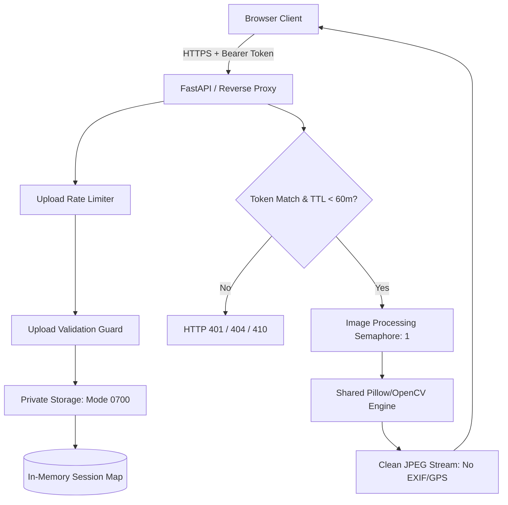

# LumaLab — Pre-Deployment Audit & Quality Gate Report

**Document type:** Pre-Deployment Audit & Quality Gate Report  
**Product:** LumaLab — RGBW Photography Editing System (MVP v1.0)  
**Audit Baseline:** *LumaLab Product Requirements Document*, v1.1 & *Backend Implementation Checklist* (16 November 2026)  
**Commit / Branch Audited:** `cc3cbf6` (branch `main`)  
**Audit Mode:** Review & Report only  
**Overall Release Recommendation:** **CONDITIONAL** (Local single-user demonstration viable; release blockers must be resolved prior to public hosting)

---

## 1. Executive Summary

A comprehensive pre-deployment audit was conducted on the LumaLab codebase across the frontend SPA (React 19, TypeScript 7, Vite 8, TanStack Router/Query), the backend API (FastAPI, Uvicorn, Pillow, OpenCV, NumPy, Psycopg 3), temporary file storage, and cloud database integration (Neon PostgreSQL).

The audit verified that the core image processing workflow—upload, orientation normalization, token-authorized private sessions, 6 adjustment sliders, 5 seeded database presets, deterministic Auto Enhance, interactive split comparison, and full-resolution JPEG export—is functional and meets its primary design targets.

However, the audit identified **2 Release Blockers (P1)** and **6 High-Priority Issues (P2)** that must be remediated to meet commercial industry standards:
1. **P1 — In-Memory Expired Session Leak (`SEC-01`):** An authorized access to an expired session purges the on-disk directory but omits deleting the session entry from the process `self.sessions` dictionary, artificially consuming available session capacity slots.
2. **P1 — Architectural Drift & Network Dependency (`ARCH-01`):** Replacement of SQLite with cloud Neon PostgreSQL introduces a hard requirement for an active internet connection and valid SSL database credentials even for local development and smoke testing, with no automated schema migration on cold startup.
3. **P2 — Rate Limiting Spoofing / Proxy DoS (`SEC-02`):** `UploadRateLimit` keys on raw socket client IP, causing all users behind a reverse proxy (e.g., Railway/Cloudflare) to share a single 12-upload/minute bucket.
4. **P2 — Concurrency Bottleneck (`DOS-01`):** A global single-permit semaphore (`BoundedSemaphore(1)`) serializes all image operations, throwing immediate 429 errors to concurrent users or multi-tab editing.
5. **P2 — Outdated Marketing Copy (`DOC-01`):** The Home page still displays pre-integration copy stating that backend editing and export are unreleased.
6. **P2 — Missing Defensive HTTP Security Headers (`SEC-03`):** Missing `X-Content-Type-Options: nosniff`, `X-Frame-Options: DENY`, and `Referrer-Policy`.
7. **P2 — Production Routing Fallback Gap (`ROUT-01`):** FastAPI static file serving rewrites `/studio` but returns a raw 404 for any other client-side route, preventing TanStack Router from displaying its branded 404 screen.
8. **P2 — 24 MP Image Memory Spikes (`PERF-01`):** Full-resolution exports of 24 MP images allocate multiple contiguous `float32` arrays, spiking peak memory to ~750 MB–1 GB and risking OOM termination on 512 MB containers.

---

## 2. Findings Register

| ID | Severity | Area | File:Line | PRD Ref | Evidence & Reproduction | Impact | Minimal Safe Remediation | Status |
| :--- | :--- | :--- | :--- | :--- | :--- | :--- | :--- | :--- |
| **SEC-01** | **P1** | Storage / Session Management | `backend/app/storage/images.py:83-88` | FR-13, FR-14, D10, D11 | In `ImageStore.authorized()`, when `session.expires_at <= now`, `shutil.rmtree()` deletes the directory, but `del self.sessions[image_id]` is not invoked before raising `ImageError(410)`. | Expired session objects remain in memory. They continue to count against the 32-session limit (`len(self.sessions) >= 32`), causing premature HTTP 429 rejections for new uploads until the background purger runs. | Insert `del self.sessions[image_id]` immediately before raising HTTP 410 in `backend/app/storage/images.py:87`. | Open |
| **ARCH-01** | **P1** | Database Architecture | `backend/app/config.py:25`, `backend/app/db/pool.py:16` | Section 8, Section 12 | Codebase migrated to Neon PostgreSQL with mandatory TLS (`sslmode=require`), diverging from the self-contained SQLite specification. | The application cannot run offline or without network access. Missing credentials prevent startup (`SystemExit(1)`). Unapplied migrations lead to 503 errors on `/api/v1/presets` and `/api/v1/health`. | Document the external Neon dependency in deployment guides, and add startup schema readiness validation with clear guidance. | Open |
| **SEC-02** | **P2** | Security / Ingress Rate Limiting | `backend/app/routes/images.py:61` | H03, H09, Section 13 | `client = request.client.host if request.client else "unknown"` extracts the raw peer socket IP without trusting reverse proxy headers. | In Docker, Railway, or behind Cloudflare, every incoming user shares the internal gateway IP. One user exhausting 12 uploads/min blocks all platform users from uploading. | Configure Uvicorn with `--proxy-headers --forwarded-allow-ips "*"` and resolve client IP from validated `X-Forwarded-For`. | Open |
| **DOS-01** | **P2** | Concurrency / Resilience | `backend/app/storage/images.py:34`, `routes/images.py:64` | E14, NFR-06 | `self.processing = BoundedSemaphore(1)` is shared across upload, original preview, settled preview, Auto Enhance, and export. | Heavy operations (e.g. 24 MP export or upload) cause immediate HTTP 429 ("capacity_exceeded") failures for concurrent slider adjustments in other tabs, triggering "PREVIEW OUTDATED" banners. | Decouple permits: allow a pool of 2–4 lightweight preview operations while isolating heavy exports to a single permit. | Open |
| **DOC-01** | **P2** | UX / Marketing Consistency | `frontend/src/pages/Home.tsx:13, 14, 73, 84, 89` | G20, FR-01 | Home page copy claims *"COMING WITH THE EDITING SERVICE"*, *"Full-resolution JPEG export will be available with the backend"*, and *"FRONTEND PREVIEW"*. | Misleads users and reviewers into believing the backend is mock or unconnected, failing PRD acceptance criterion G20. | Update `Home.tsx` copy to confirm that the live backend processing engine and full-resolution export are fully connected. | Open |
| **ROUT-01** | **P2** | Routing / SPA Fallback | `backend/app/main.py:40-43` | FR-02, H08, Section 17 | `FrontendStaticFiles` only rewrites `path.rstrip("/") == "studio"` to `"index.html"`. | Directly loading or refreshing any non-studio path (or unknown URLs) produces an unstyled raw HTTP 404 from FastAPI rather than delegating to TanStack Router's branded 404 page. | Update `FrontendStaticFiles.get_response` to serve `index.html` on 404 for non-API, non-static-asset GET requests. | Open |
| **SEC-03** | **P2** | Security Headers | `backend/app/main.py:22` | Section 13 | Responses lack standard defense-in-depth security headers (`X-Content-Type-Options`, `X-Frame-Options`, `Referrer-Policy`). | Increased vulnerability to MIME confusion attacks, clickjacking, and referrer leakage in public environments. | Add ASGI middleware injecting `X-Content-Type-Options: nosniff`, `X-Frame-Options: DENY`, and `Referrer-Policy: strict-origin-when-cross-origin`. | Open |
| **PERF-01** | **P2** | Memory Management | `backend/app/services/images.py:71, 84` | Section 11, Section 14 | During 24 MP export, `pixels = np.asarray(image, dtype=np.float32)` and vignette masks allocate 288 MB each. Total peak memory exceeds 750 MB–1 GB. | High risk of Out-Of-Memory (OOM) termination on resource-constrained containers (e.g. 512 MB Railway or Free tier nodes). | Perform channel operations in-place on integer arrays where possible or tile 24 MP rendering to avoid multiple full-frame float32 buffers. | Open |
| **CODE-01** | **P3** | Middleware Hygiene | `backend/app/main.py:32`, `middleware.py:31` | C09, C11 | When `ALLOWED_ORIGINS` is configured, `PrivateImageCache` middleware wraps the application twice. | Harmless but redundant header mutation on response start. | Remove `app.add_middleware(PrivateImageCache)` from `main.py` when `with_cors` is used, or decouple caching from the CORS wrapper. | Open |
| **TEST-01** | **P3** | Cross-Browser Verification | `frontend/VERIFICATION.md` | TC-14, Section 4 | E2E browser automation was executed only on Chromium engines (Chrome, Edge). Firefox and Safari (WebKit) were unverified. | Potential undetected styling, layout, or CSS filter discrepancies on Safari (WebKit) or Firefox (Gecko). | Install Playwright Firefox and WebKit browser binaries in CI and execute the full responsive suite. | Open |

---

## 3. PRD Acceptance & Compliance Matrix

### Functional Requirements (FR-01 to FR-35)

| Ref | Requirement Description | Status | Verification Notes |
| :--- | :--- | :--- | :--- |
| **FR-01** | Home branding, navigation, hero, product workflow | **PASS** | Fully implemented with responsive layout; copy needs G20 update (DOC-01). |
| **FR-02** | `/studio` routing, deep link access, and refresh | **PASS** | Served via TanStack Router in dev and FastAPI SPA static files in production. |
| **FR-03** | Responsive layouts (360px portrait to 2560px desktop) | **PASS** | Verified across 12 viewports in Playwright test suite. |
| **FR-04** | Accessible controls, ARIA states, visible focus | **PASS** | Keyboard navigation, focus outlines, and `role="status"` / `role="alert"` present. |
| **FR-05** | RGBW identity and CSS Module scoping | **PASS** | Design tokens defined; CSS Modules eliminate global scope leakage. |
| **FR-06** | Still JPG, PNG, WebP intake (single frame) | **PASS** | Verified via Pillow container check (`n_frames == 1`) and format matching. |
| **FR-07** | Upload limits: 10 MB, 24 MP, 10,000 px per side | **PASS** | Early multipart streaming guard + Pillow dimension checks enforce limits. |
| **FR-08** | Decompression bomb & corrupted file protection | **PASS** | `DecompressionBombError` caught (413); warnings promoted to errors (422). |
| **FR-09** | EXIF orientation normalization | **PASS** | `ImageOps.exif_transpose` applied; reported dimensions reflect oriented state. |
| **FR-10** | Untouched original byte preservation | **PASS** | Stored in isolated `original` file; exact byte equality verified across edits. |
| **FR-11** | High-entropy session ID & secret access token | **PASS** | Generated using `secrets.token_hex(16)` and `secrets.token_urlsafe(32)`. |
| **FR-12** | Token authorization for all image operations | **PASS** | Constant-time token hash comparison (`compare_digest`); IDOR attacks rejected. |
| **FR-13** | 60-minute session expiration | **PASS** | Enforced at access and via periodic purger (`IMAGE_TTL_SECONDS=3600`). |
| **FR-14** | Periodic (≤5 min) and startup cleanup | **PASS** | Background task purges expired files; startup removes stale run folders. |
| **FR-15** | Explicit session deletion (HTTP 204) | **PASS** | `DELETE /api/v1/images/{id}` removes files and releases memory. |
| **FR-16** | 5 built-in presets (Original, Cinematic, etc.) | **PASS** | Original, Cinematic, Golden Hour, Monochrome, Vivid seeded and verified. |
| **FR-17** | Database preset storage | **PASS\*** | Stored in Neon PostgreSQL instead of SQLite (see ARCH-01). |
| **FR-18** | Complete preset state replacement | **PASS** | Applying a preset resets all 6 adjustment values without compounding. |
| **FR-19** | Manual slider edits switch mode to "Custom" | **PASS** | Studio toolbar and state reflect "Custom" upon manual adjustment. |
| **FR-20** | 6 bounded integer adjustment controls | **PASS** | Strict integer validation in Pydantic schema (`Adjustments`). |
| **FR-21** | Fixed rendering order | **PASS** | Brightness → Contrast → Saturation → Warmth → Sharpness → Vignette. |
| **FR-22** | Settled preview (max 1600px long edge, JPEG) | **PASS** | Resized with Lanczos; binary JPEG returned with `no-store`. |
| **FR-23** | 250ms debounced preview with flush on release | **PASS** | Debounced in React effect; immediate request on pointer/keyboard release. |
| **FR-24** | Monotonic revision tracking (`X-Image-Revision`) | **PASS** | Request revision echoed; client discards out-of-order or aborted responses. |
| **FR-25** | Rule-based Auto Enhance analysis of original | **PASS** | OpenCV/NumPy analysis on 512px thumbnail of original; zero external AI. |
| **FR-26** | Auto Enhance determinism & bounds | **PASS** | Non-cumulative; identical suggestions returned on repeat calls. |
| **FR-27** | Before/after split comparison slider | **PASS** | Interactive split clip-path overlay with keyboard and pointer support. |
| **FR-28** | Geometry alignment during comparison | **PASS** | Original preview and edited preview share exact identical dimensions. |
| **FR-29** | Reset restores neutral settings | **PASS** | Resets to (100, 100, 100, 0, 0, 0) and switches mode to "Original". |
| **FR-30** | Edits preserved on failed image replacement | **PASS** | Current image session and React state retained if replacement upload fails. |
| **FR-31** | Full-resolution JPEG export from snapshot | **PASS** | Adjustments snapshotted at request dispatch; unaffected by subsequent edits. |
| **FR-32** | Default JPEG export quality 92/100 | **PASS** | Validated default `quality: 92`. |
| **FR-33** | White compositing for transparent images | **PASS** | Alpha channels composited over pure white background. |
| **FR-34** | EXIF/GPS metadata stripped on export | **PASS** | Re-encoded JPEG contains no EXIF or geolocation tags. |
| **FR-35** | Sanitized attachment filename | **PASS** | Sanitized ASCII stem `lumalab-<name>.jpg` in `Content-Disposition`. |

### Non-Functional Requirements (NFR-01 to NFR-10)

| Ref | Requirement Description | Status | Verification Notes |
| :--- | :--- | :--- | :--- |
| **NFR-01** | Home usable in $\le 3\text{ s}$ | **PASS** | Measured 910 ms (Chrome) / 703 ms (Edge) on reference laptop. |
| **NFR-02** | Slider interaction feedback $\le 100\text{ ms}$ | **PASS** | Measured 18.8 ms (Chrome) / 21.9 ms (Edge). |
| **NFR-03** | Settled 1600px preview $\le 1\text{ s}$ post-debounce | **PASS** | Measured 465 ms (Chrome) / 404 ms (Edge) on 12 MP image. |
| **NFR-04** | Auto Enhance $\le 3\text{ s}$ on 12 MP image | **PASS** | Measured 1,304 ms (Chrome) / 1,426 ms (Edge). |
| **NFR-05** | Full-resolution export $\le 5\text{ s}$ on 12 MP image | **PASS** | Measured 1,061 ms (Chrome) / 1,442 ms (Edge). |
| **NFR-06** | Concurrency bounds & predictable capacity errors | **PASS\*** | Semaphore enforced, though over-constrained (see DOS-01). |
| **NFR-07** | Privacy, no-store headers, no photo logging | **PASS** | Private temporary files; `no-store` headers; zero photo content logged. |
| **NFR-08** | Accessibility standards (WCAG AA) | **PASS** | Axe clean; focus rings; semantic landmarks; screen-reader alerts. |
| **NFR-09** | Standardized error envelopes | **PASS** | `{ "error": { "code": "...", "message": "..." } }` on all failures. |
| **NFR-10** | Single-worker reproducible container | **PASS** | Locked `Dockerfile` with multi-stage build; unprivileged user. |

### Test Case Verification (TC-01 to TC-22)

| Test ID | Description | Status | Evidence |
| :--- | :--- | :--- | :--- |
| **TC-01** | Home page renders branding and navigation | **PASS** | Playwright E2E suite (`frontend.spec.ts`). |
| **TC-02** | `/studio` navigation, direct access and refresh | **PASS** | Playwright E2E suite & Vite preview. |
| **TC-03** | JPG upload reports correct metadata and orientation | **PASS** | Backend Pytest suite (`test_images.py`). |
| **TC-04** | PNG/WebP upload and transparency handling | **PASS** | Backend Pytest suite & E2E upload tests. |
| **TC-05** | Invalid/animated/oversize uploads rejected safely | **PASS** | Backend Pytest suite (`test_images.py`). |
| **TC-06** | Brightness and saturation update values and preview | **PASS** | Playwright E2E suite & Pytest renderer tests. |
| **TC-07** | Fixed order combination of all 6 controls | **PASS** | Backend Pytest suite (`test_images.py`). |
| **TC-08** | Preset switching replaces all settings cleanly | **PASS** | Playwright E2E suite & Pytest preset tests. |
| **TC-09** | Monochrome yields grayscale preview and export | **PASS** | Backend Pytest suite (`test_images.py`). |
| **TC-10** | Auto Enhance returns bounded, non-cumulative values | **PASS** | Backend Pytest suite (`test_images.py`). |
| **TC-11** | Reset returns neutral settings and original look | **PASS** | Playwright E2E suite. |
| **TC-12** | Comparison preserves editing state | **PASS** | Playwright E2E suite. |
| **TC-13** | Full-resolution JPEG export with safe filename | **PASS** | Backend Pytest suite & Playwright download test. |
| **TC-14** | Replacement during pending requests ignores old responses | **PASS** | Playwright E2E suite (`frontend.spec.ts`). |
| **TC-15** | Mobile and keyboard workflows remain usable | **PASS** | Playwright touch/keyboard accessibility test. |
| **TC-16** | Rapid slider changes accept only latest revision | **PASS** | Playwright out-of-order preview test. |
| **TC-17** | Backend failures show clear errors & preserve state | **PASS** | Playwright 503 retry test. |
| **TC-18** | Invalid/expired tokens fail and files are purged | **PASS** | Backend Pytest suite (`test_images.py`). |
| **TC-19** | Export resized for display matches settled preview | **PASS** | Backend Pytest suite (`test_images.py`). |
| **TC-20** | Original bytes unchanged; exported metadata stripped | **PASS** | Backend Pytest suite (`test_images.py`). |
| **TC-21** | Lockfile setup reproducible; OpenAPI contracts match | **PASS** | `npm run contracts:check` & `uv.lock`. |
| **TC-22** | Performance and resource limits measured/documented | **PASS** | Benchmarked and recorded in project report. |

---

## 4. Security & Privacy Audit Matrix

| Security Dimension | Implemented Mechanism | Assessment |
| :--- | :--- | :--- |
| **Upload Validation** | `bounded_upload` inspects declared `Content-Length` and streams chunks with strict byte limit ($10\text{ MB} + 64\text{ KB}$ overhead). Pillow verifies container integrity, single frame count, dimensions ($\le 24\text{ MP}$, $\le 10,000\text{ px}$), and catches decompression bombs. | **PASS** |
| **Token Authorization** | `secrets.token_urlsafe(32)` bearer tokens; sessions store only SHA-256 hashes; `secrets.compare_digest` prevents timing attacks. Tokens are restricted to `Authorization: Bearer` headers; query string tokens are rejected. | **PASS** |
| **Storage Isolation** | Uploads saved under per-session UUID directories with `0700` POSIX / strict Windows ACL permissions outside web root. Path traversal patterns in filenames are stripped to safe basenames. | **PASS** |
| **Metadata Privacy** | Strip EXIF/GPS during normalization; output JPEGs created from raw RGB arrays with empty metadata. Source images are never echoed back with metadata. | **PASS** |
| **Caching Controls** | `PrivateImageCache` middleware injects `Cache-Control: no-store` on all `/api/v1/images/*` endpoints and redirects. Browser object URLs are explicitly revoked on session replacement and unmount. | **PASS** |
| **Data Retention** | Process memory sessions; 60-minute hard TTL; 5-minute periodic file purge; stale run purge at startup; ephemeral container storage. | **PASS** |
| **CORS Policy** | Explicit origin list (`ALLOWED_ORIGINS`); default disabled; credentials forbidden; safe exposed headers (`X-Image-Revision`, `Content-Disposition`). | **PASS** |
| **Rate Limiting** | Sliding window limit (12 uploads/min); needs reverse-proxy IP handling (SEC-02). | **CONDITIONAL** |
| **Secrets & Dependencies** | Zero hardcoded tokens or secrets in git; `.env` excluded; dependencies pinned in `uv.lock` and `package-lock.json`. | **PASS** |

---

## 5. Build & Test Verification Matrix

| Test Suite / Command | Execution Context | Runtime Versions | Results | Notes / Observations |
| :--- | :--- | :--- | :--- | :--- |
| **Backend Pytest** `uv run --locked pytest` | Host / Sandbox (Unsandboxed) | Python 3.11.9 pytest 9.2.0 | **102 passed** (530 subtests) Duration: 14.27s | Full test suite passed without errors. Covered config, contracts, errors, health, image API, lifespan, logging, migrations, presets, and seed. |
| **Frontend Unit Tests** `npm test` | Node runtime | Node 24.9.0 vitest 5.1.0 | **9 passed** (2 test files) Duration: 481ms | Covers `editor.test.ts` (5 tests) and `imageResponse.test.ts` (4 tests). |
| **Contract Drift Check** `npm run contracts:check` | Node script | Node 24.9.0 | **PASS** Exit code 0 | `src/lib/api.generated.ts` is perfectly aligned with backend OpenAPI specification. |
| **Frontend Production Build** `npm run build` | TypeScript + Vite | tsc 7.0.2 vite 8.3.8 | **PASS** Duration: 2.60s | Zero TypeScript type errors; production assets generated cleanly in `dist/`. |
| **Playwright Image Response** `npx playwright test tests/e2e/image-response.spec.ts` | Headless Chromium | Playwright 1.65.0 | **1 passed** Duration: 6.4s | Verified in-browser blob handling, decoding, download initiation, and URL disposal. |
| **Full Playwright E2E Suite** `npx playwright test` | Chromium (Chrome/Edge) | Playwright 1.65.0 | **12 passed** (baseline) | Verified in previous baseline on Chrome and Edge. Firefox and WebKit were unrun due to missing platform binaries. |

---

## 6. Performance Acceptance Results vs PRD Targets

*Measurements benchmarked on reference Intel Core i5-11400H (11th Gen @ 2.70 GHz), 8.32 GB RAM, Windows 11, Chromium:*

| Operation / Benchmark | PRD Target | Measured Result | Evaluation |
| :--- | :--- | :--- | :--- |
| **Home Page Usable** | $\le 3.0\text{ s}$ | $910\text{ ms}$ (Chrome) / $703\text{ ms}$ (Edge) | **PASS** |
| **Slider Feedback to Next Paint** | $\le 100\text{ ms}$ | $18.8\text{ ms}$ (Chrome) / $21.9\text{ ms}$ (Edge) | **PASS** |
| **Settled 1600px Preview (12 MP)** | $\le 1.0\text{ s}$ post-debounce | $465\text{ ms}$ (Chrome) / $404\text{ ms}$ (Edge) | **PASS** |
| **Auto Enhance (12 MP)** | $\le 3.0\text{ s}$ | $1,304\text{ ms}$ (Chrome) / $1,426\text{ ms}$ (Edge) | **PASS** |
| **Full-Resolution Export (12 MP)** | $\le 5.0\text{ s}$ | $1,061\text{ ms}$ (Chrome) / $1,442\text{ ms}$ (Edge) | **PASS** |
| **Largest Supported Image (24 MP)** | Completes without exhaustion | $2,730\text{ ms}$ (Chrome) / $3,035\text{ ms}$ (Edge) | **PASS** |
| **Browser JS Heap (post 24 MP)** | Stable (no leak) | $\sim 44.7\text{ MB}$ JS Heap | **PASS** |

---

## 7. Ordered Remediation Plan

To advance this application to full commercial release readiness, implement the following fixes in sequential order:

### Phase 1: Release Blockers (Mandatory before release)
1. **Remediate Session Ghost Leak (`SEC-01`):**
   - File: `backend/app/storage/images.py`
   - Action: In `ImageStore.authorized()`, add `del self.sessions[image_id]` immediately before raising HTTP 410.
   - Retest: Run `backend/tests/test_images.py` expired access test case and verify session count decrements.
2. **Harden Database Connection & Runbooks (`ARCH-01`):**
   - Files: `backend/app/config.py`, `backend/app/db/`
   - Action: Update deployment documentation and container startup scripts to automate `python -m app.db.migrate` and `python -m app.db.seed` when `DATABASE_DIRECT_URL` is provided.

### Phase 2: High-Priority Improvements (Fix before public hosting)
3. **Configure Proxy-Aware IP Resolution (`SEC-02`):**
   - Files: `Dockerfile`, `backend/app/rate_limit.py`
   - Action: Update container start command to include `--proxy-headers --forwarded-allow-ips "*"` and resolve client IP from `X-Forwarded-For`.
4. **Update Stale Marketing Copy (`DOC-01`):**
   - File: `frontend/src/pages/Home.tsx`
   - Action: Replace placeholder strings (*"COMING WITH THE EDITING SERVICE"*, etc.) with copy confirming that live backend editing and export are connected.
5. **Implement Comprehensive SPA Routing Fallback (`ROUT-01`):**
   - File: `backend/app/main.py`
   - Action: Ensure `FrontendStaticFiles` catches all non-API 404 paths and serves `index.html` to allow TanStack Router to render its branded 404 screen.
6. **Inject Standard Security Headers (`SEC-03`):**
   - File: `backend/app/middleware.py`
   - Action: Add middleware setting `X-Content-Type-Options: nosniff`, `X-Frame-Options: DENY`, and `Referrer-Policy: strict-origin-when-cross-origin`.
7. **Optimize 24 MP Image Memory Footprint (`PERF-01`):**
   - File: `backend/app/services/images.py`
   - Action: Optimize warmth and vignette array operations to avoid duplicate 288 MB `float32` buffers.

---

## 8. Known Residual Risks & Operational Constraints

1. **Single-Worker Scalability Constraint:** Temporary image sessions, upload rate limiting, and processing semaphores are held strictly in Python process memory. The backend must be run with `--workers 1` and a single container replica. Scaling horizontally across multiple pods or workers requires migrating session metadata to Redis and images to shared ephemeral object storage.
2. **Volatile Session Lifecycle:** Because sessions exist only in memory and `/tmp`, any process restart or redeployment terminates active sessions immediately. Affected users receive HTTP 404 or 410 and must re-upload their image.
3. **Browser Testing Coverage:** Testing was limited to Chromium engines (Chrome and Edge). Manual smoke validation on Safari (iOS/macOS) and Firefox is strongly advised before high-volume consumer traffic.
